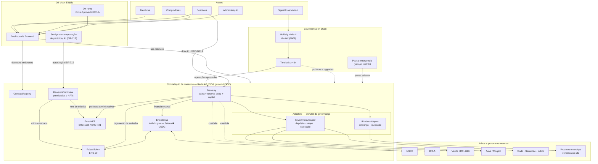

[](LICENSE)


[](https://github.com/Rede-ENois/smartcontracts/issues)

**Participação que gera reconhecimento. Tecnologia a serviço da comunidade.**

Este repositório é a base de contratos inteligentes do **Ecossistema DeFi da Rede É Nóis**, projeto que combina **gamificação e finanças descentralizadas (DeFi)**. A proposta é reconhecer a participação na rede, incentivar contribuições e organizar a gestão transparente dos recursos comunitários.

O ecossistema terá como elementos centrais a moeda **Faísca**, os NFTs de reconhecimento e colecionáveis, um swap próprio e uma **Tesouraria** responsável pelos recebimentos, investimentos e saques, com governança por múltiplas assinaturas.

> **Estado atual:** fase de concepção e documentação inicial. As funcionalidades abaixo são requisitos e propostas de arquitetura, não serviços disponíveis. Neste momento, o repositório não contém contratos implementados, configuração de compilação, testes ou endereços de deploy. Parâmetros econômicos e integrações dependerão de validação, simulações, aprovação da governança e revisão de segurança.

## 1. Objetivos

- Premiar membros por participação e contribuições à Rede É Nóis.
- Reconhecer doadores com gratificações em Faísca, conforme políticas públicas da rede.
- Permitir a aquisição e troca de Faísca por meio de um swap próprio com USDC.
- Usar Faísca para adquirir funcionalidades, benefícios e experiências na plataforma.
- Emitir NFTs de conquistas, funções comunitárias, campanhas e coleções especiais.
- Administrar recursos por uma tesouraria transparente, com segregação de fundos e controles de risco.
- Evoluir os contratos sem concentrar o poder de atualização em uma única carteira.

## 2. Moeda Faísca

A **Faísca** será o token fungível de utilidade do ecossistema, com implementação prevista baseada no padrão **ERC-20**. Símbolo, casas decimais e rede de implantação ainda serão definidos.

### Como obter Faísca

| Modalidade | Funcionamento previsto |
|---|---|
| Participação | Premiação por ações e metas reconhecidas pela Rede É Nóis. |
| Doações | Gratificação proporcional segundo regras de campanha aprovadas e divulgadas. |
| Compra | Aquisição de USDC por on-ramp e troca por Faísca no swap da rede. |
| Troca | Negociação de Faísca por USDC e vice-versa, conforme liquidez e regras do swap. |

Os valores das premiações serão configurados em **telas administrativas desenvolvidas pela equipe do dashboard/frontend**. O frontend será uma interface: as permissões, os parâmetros autorizados e a validação das distribuições deverão ser aplicados nos contratos e nos serviços responsáveis por comprovar a participação.

As premiações deverão ser rastreáveis, com prevenção de duplicidade, abuso de contas e reaproveitamento de autorizações. Não serão publicados dados pessoais dos participantes na blockchain.

### Emissão e queima

- **Mint:** não haverá teto máximo global de emissão de Faísca.
- **Burn:** a infraestrutura permitirá queimas autorizadas, por exemplo em usos definidos para funcionalidades da rede ou redução de oferta.
- **Controle:** ausência de teto não significa emissão aberta ao público. A emissão dependerá de papéis autorizados, políticas de distribuição e controles auditáveis.
- **Transparência:** emissão, queima e mudanças de política deverão produzir registros verificáveis.

**Novas emissões não criam USDC nem lastro.** Premiações e gratificações podem ampliar a pressão de venda e reduzir o preço no swap. Recomenda-se orçamento de emissão por período, monitoramento da oferta e limites operacionais ajustáveis por governança, sem impor um teto total ao token.

A Faísca não será apresentada como stablecoin, participação societária, direito automático sobre a tesouraria ou promessa de rendimento. Sua utilização, distribuição e negociação dependerão também de avaliação jurídica aplicável.

## 3. Compra com USDC e swap da Rede É Nóis

### Jornada planejada

1. A pessoa conecta uma carteira compatível à plataforma.
2. Adquire USDC usando um fluxo de **on-ramp integrado ao ecossistema Circle**, sujeito à disponibilidade comercial e regional.
3. Recebe USDC na rede blockchain suportada pelo projeto.
4. Consulta a cotação do swap, as taxas, o impacto no preço e o valor mínimo a receber.
5. Autoriza o uso do USDC e confirma a troca por Faísca em sua carteira.
6. Utiliza as moedas na rede ou as mantém em sua carteira.

O caminho inverso permitirá trocar Faísca por USDC **somente conforme a liquidez disponível**. Conversão posterior de USDC em moeda fiduciária dependerá de um serviço de off-ramp separado, não garantido por este projeto.

**Integração Circle a confirmar:** a documentação distingue o Circle Mint, voltado a instituições elegíveis, dos fluxos com provedores de on-ramp. A integração final deverá confirmar produto ou parceiro, países atendidos, redes, métodos de pagamento, custos e requisitos de identificação e conformidade. Não se presume acesso direto de qualquer pessoa ao Circle Mint.

### Proposta econômica: swap de reservas reais com produto constante

Para evitar uma obrigação de recompra que onere a Rede É Nóis, propõe-se iniciar com um **formador automatizado de mercado (AMM) de produto constante**, abastecido com reservas reais de Faísca e USDC. Trata-se de uma proposta para simulação, não de uma política já aprovada.

O swap será contabilmente segregado dos recursos operacionais e dos investimentos da tesouraria. Apenas o USDC efetivamente reservado ao swap poderá pagar suas trocas.

Definições, usando valores normalizados pelas casas decimais dos tokens:

- `x`: quantidade real de Faísca na reserva do swap.
- `y`: quantidade real de USDC na reserva do swap, livre de obrigações externas.
- `k = x × y`: produto das reservas, constante em uma troca ideal sem taxas.
- `p = y / x`: preço marginal indicativo em USDC por Faísca, antes de taxas e impacto da ordem.
- `f`: taxa proporcional de negociação, a definir pela governança, com `0 ≤ f < 1`.

Para comprar Faísca com `u` USDC:

```text
u_efetivo = u × (1 − f)
Faísca_recebida = x × u_efetivo / (y + u_efetivo)
```

Para vender `q` Faíscas por USDC:

```text
q_efetivo = q × (1 − f)
USDC_recebido = y × q_efetivo / (x + q_efetivo)
```

Nesta proposta, a taxa permanece na reserva do ativo de entrada: o saldo recebe o valor integral enviado, mas a cotação considera apenas o valor efetivo. Assim, `k` pode aumentar após as trocas com taxa. Qualquer futura destinação das taxas exigirá contabilidade e fórmulas coerentes.

**Exemplo ilustrativo, sem taxa:** com `100.000` Faíscas e `10.000` USDC, o preço marginal inicial é `0,10` USDC por Faísca. Uma compra de `1.000` USDC entrega aproximadamente `9.090,91` Faíscas. As reservas passam a aproximadamente `90.909,09` Faíscas e `11.000` USDC, com preço marginal próximo de `0,121` USDC. O preço médio da compra difere da cotação marginal.

### Como esse modelo protege a rede

- Não promete preço mínimo, paridade ou recompra ilimitada.
- Para reservas positivas e entrada finita, a saída calculada é inferior à reserva de saída; arredondamentos e validações deverão preservar essa propriedade.
- Compras aumentam a reserva de USDC e reduzem a de Faísca, elevando o preço marginal; vendas fazem o movimento contrário.
- Grandes ordens sofrem maior impacto no preço, em vez de serem liquidadas integralmente por uma cotação fixa potencialmente insustentável.
- Não conta com rendimentos futuros nem com ativos ilíquidos para honrar trocas imediatas.

**O preço não depende apenas do saldo de USDC.** Ele depende da relação entre as duas reservas. Aportar USDC isoladamente aumenta o preço marginal; aportar ambos os ativos na mesma proporção aumenta a profundidade sem alterar esse preço. Faíscas emitidas fora do swap não alteram imediatamente a cotação, mas suas vendas podem consumir USDC e desvalorizar a moeda.

### Condições e limites

- A liquidez inicial precisará ser financiada e aprovada; o AMM não cria recursos do nada.
- O preço de lançamento dependerá da proporção inicial das reservas, fundamentada por simulações.
- USDC comprometido com o swap não poderá ser simultaneamente aplicado em estratégias de investimento ou contabilizado como caixa operacional disponível.
- O saldo total da tesouraria, incluindo investimentos, não será usado como cotação de resgate.
- Serão necessários proteção contra reentrância, valor mínimo de saída, prazo de validade, limites operacionais e tratamento seguro de precisão e arredondamento.
- A cotação instantânea do próprio swap não deverá ser usada como oráculo confiável para premiações, crédito ou avaliação de investimentos; é manipulável e exposta a MEV.
- Adição ou retirada administrativa de liquidez deverá passar pela governança, com transparência sobre o impacto e preservação dos compromissos existentes.
- Não há garantia de liquidez permanente nem proteção absoluta contra perdas, arbitragem, volatilidade ou falhas de contratos.

Caso as premiações gerem vendas persistentemente superiores às compras e aos aportes, o preço e a reserva de USDC cairão. A resposta deverá ser revisão transparente de incentivos e orçamento, não uma obrigação automática de a rede cobrir perdas. O modelo reduz compromissos financeiros abertos, mas não elimina riscos nem assegura sustentabilidade por si só.

## 4. Tesouraria: centro da infraestrutura

A arquitetura será organizada em torno da **Tesouraria da Rede É Nóis**, responsável pela coordenação financeira e pelas autorizações dos módulos.

### Responsabilidades previstas

- Receber doações e outros recursos destinados ao projeto.
- Segregar recursos operacionais, liquidez do swap e capital autorizado para investimento.
- Executar saques e alocações aprovados pela governança.
- Coordenar políticas e permissões de emissão e queima de Faísca.
- Registrar movimentações e disponibilizar dados para acompanhamento no dashboard.
- Interagir com estratégias externas por meio de adapters autorizados.

Centralidade da tesouraria não significa concentrar toda a lógica em um contrato monolítico. Tokens, NFTs, swap e adapters deverão ter responsabilidades delimitadas e permissões mínimas.

### Investimentos e adapters

Parte do capital recebido por doações poderá ser aplicada em estratégias aprovadas, respeitando a finalidade das doações, necessidades operacionais, reservas de segurança e restrições legais.

A infraestrutura prevê integração com **vaults ERC-4626** e outros formatos por meio de adapters. Um adapter deverá compatibilizar depósitos, posições, retiradas e informações de risco com a infraestrutura É Nóis, sem presumir que todos os protocolos têm as mesmas garantias.

Entre as opções de investimento a avaliar estão **Aave, Morpho, xStoks, Ondo, Dinari (dShares) e Securitize**. Nenhuma integração está implementada ou aprovada. A identificação dos produtos, sua disponibilidade e sua adequação à tesouraria deverão ser confirmadas antes de qualquer integração, incluindo requisitos de elegibilidade, identificação, restrições jurisdicionais, transferência e resgate.

Essas opções não devem ser tratadas genericamente como vaults ERC-4626 nem como produtos equivalentes entre si. Cada integração dependerá do produto escolhido e poderá exigir um adapter específico, além de avaliação dos riscos de protocolo, emissor, custódia, contraparte e liquidez, conforme aplicável.

Critérios propostos para cada estratégia:

- Contratos e ativos permitidos, com revisão independente de segurança.
- Limite de exposição por protocolo, ativo e estratégia.
- Disponibilidade de resgate, prazos, filas, taxas e perdas possíveis.
- Compatibilidade do ativo de entrada com USDC e eventuais riscos de conversão.
- Validação do valor das posições, sem presumir que a conversão indicada por um vault garante liquidez imediata.
- Testes específicos para manipulação da cota, arredondamentos e ataques de inflação em vaults.
- Monitoramento de perdas, indisponibilidade, mudanças externas e plano de saída.

**Rendimentos não são garantidos.** Perdas, bloqueios e falhas externas podem atingir o capital aplicado. O destino dos resultados será definido por governança; possuir Faísca não dará automaticamente direito a rendimentos ou a cotas das aplicações.

## 5. Governança multisig e atualizações

### Quórum de dois terços

As decisões críticas deverão exigir um multisig **M-de-N**, em que `N` é o número total de signatários autorizados e:

```text
M = teto(2 × N / 3)
```

Exemplos: `2 de 3`, `4 de 5`, `4 de 6` e `5 de 7`.

O denominador será o **total de signatários autorizados**, não apenas quem comparecer ou votar. Abstenções não reduzirão o quórum. Ter Faísca ou um NFT não concederá automaticamente poderes administrativos.

Exigirão esse controle, entre outras ações:

- Upgrades dos contratos e alterações de módulos.
- Saques administrativos, investimentos e desinvestimentos.
- Inclusão ou substituição de adapters e protocolos permitidos.
- Alterações sensíveis nas políticas de emissão, taxas e liquidez.
- Concessão de permissões críticas e mudanças na composição do multisig.

As mudanças sensíveis deverão passar por **timelock on-chain de pelo menos 48 horas**, conforme política de segurança. Uma pausa emergencial poderá ter um fluxo restrito próprio, sem permitir saques, upgrades ou retomada irrestrita por uma chave isolada. O fluxo de emergência ainda será especificado.

Operações rotineiras de usuários e premiações dentro de políticas previamente aprovadas não precisarão de votação individual, mas permanecerão sujeitas a permissões e limites verificáveis.

### Diamond e UUPS: decisão arquitetural pendente

A visão inicial pede expansão modular e contratos atualizáveis. É importante distinguir:

- **Diamond — ERC-2535:** distribui funcionalidades em módulos chamados *facets*, com atualização do conjunto de funções expostas.
- **UUPS — ERC-1822, normalmente com proxy ERC-1967:** atualiza a implementação associada a um proxy; a autorização do upgrade fica na implementação.

**“Diamond Proxy UUPS” não é um padrão único.** Não se assume a combinação automática dos dois mecanismos. A proposta é avaliar Diamond para um núcleo modular ou contratos separados com proxies UUPS, escolhendo a alternativa após modelagem de ameaças, análise de armazenamento, custos e auditoria. Uma composição híbrida só deverá ser adotada com justificativa explícita e revisão especializada.

Independentemente da escolha, serão necessários inicialização protegida, compatibilidade de armazenamento, testes de preservação de estado, governança multisig, timelock e validação do código de cada atualização.

## 6. NFTs: reconhecimento, identidade comunitária e coleções

A Rede É Nóis terá NFTs que representem conquistas, participação, funções comunitárias e coleções especiais. Os critérios de emissão, nomes, quantidades, preços e campanhas serão definidos pela **Administração da Rede É Nóis**.

### Categorias

| Categoria | Uso previsto | Transferência |
|---|---|---|
| Conquistas e reconhecimento | Metas, participação e funções na rede. | Poderá ser intransferível, conforme a coleção. |
| Colecionáveis | Itens de campanhas, eventos e coleções. | Poderá permitir venda e troca entre detentores. |
| NFTs compráveis | Itens adquiridos segundo regras comerciais da rede. | Política definida e divulgada por coleção. |

Exemplos ilustrativos de conquistas: **“Perfil Completo”**, **“Admin de Comunidade”** e **“Participante Ativo”**. Os nomes finais serão definidos pela administração.

Uma mesma conquista poderá ser atribuída a diversos membros. Isso significa múltiplas unidades de uma mesma edição ou tipo de NFT, não exclusividade de um único dono. O padrão **ERC-1155** é um candidato natural para essas edições; **ERC-721** poderá ser avaliado para itens individualizados. As regras de intransferibilidade deverão ser impostas no contrato, não apenas ocultadas na interface.

NFTs de funções administrativas não deverão conceder permissões de contrato por simples posse. Critérios de revogação, expiração e atualização de conquistas deverão ser definidos por coleção.

### Resgates em eventos

Em eventos especiais, poderão ser distribuídas **chaves ou códigos de resgate** de uma edição. Os primeiros `X` resgates válidos poderão receber uma unidade, até o limite global da campanha.

Requisitos previstos:

- Limite global `X` de emissões e, quando aplicável, limite por carteira ou participante elegível.
- Contagem atômica no contrato para impedir ultrapassagem do limite em resgates concorrentes.
- Definição de “primeiros” pela ordem de execução válida na blockchain, não pelo clique na interface.
- Autorizações vinculadas à carteira, campanha e rede, com validade e proteção contra reutilização.
- Evitar códigos secretos publicados em texto aberto nas transações; avaliar assinaturas, provas de elegibilidade ou compromisso e revelação para mitigar cópia e front-running.
- Proteções contra bots e múltiplas contas, sem presumir que uma carteira equivale a uma pessoa.

### Exibição em perfis e carteiras

Os NFTs poderão aparecer no perfil do membro na Rede É Nóis e em carteiras compatíveis, como MetaMask. A exibição dependerá da rede, do padrão, dos metadados e do suporte da carteira; detecção automática não é garantida. Metadados e imagens deverão ter política de persistência e atualização, sem exposição de dados pessoais.

## 7. Visão dos módulos



O diagrama representa responsabilidades e fluxos planejados, não contratos já implantados. O frontend administrará a experiência; contratos e serviços de validação aplicarão as regras. A tesouraria não deverá movimentar carteiras pessoais sem autorização do detentor.

## 8. Segurança e transparência

Antes de disponibilizar contratos que movimentem recursos reais, o projeto deverá contar com:

- Testes unitários, de integração, de invariantes e fuzzing das regras financeiras.
- Revisão de controle de acesso, assinaturas, prevenção de replay e reentrância.
- Auditoria independente dos contratos centrais e revalidação das correções.
- Testes de upgrades e dos adapters em ambientes controlados e forks apropriados.
- Código-fonte verificável e divulgação dos endereços de contratos, multisig e timelock.
- Monitoramento de emissões, reservas, posições, saques e alterações administrativas.
- Plano de resposta a incidentes e mecanismos de pausa com escopo definido.
- Proteção de segredos fora do repositório e minimização de dados pessoais on-chain.

Os riscos incluem vulnerabilidades de contratos, comprometimento de signatários, alterações de governança, perda de liquidez, diluição, manipulação de mercado, falhas de integrações e riscos próprios do USDC, incluindo desvinculação de preço e restrições do emissor. USDC não é ausência de risco nem uma cotação garantida em moeda fiduciária para o usuário final.

## 9. Desenvolvimento e próximos passos

### Situação do ambiente

Ainda não há dependências, scripts de instalação, compilação, testes ou deploy configurados neste repositório. Portanto, não há comandos de execução disponíveis neste estágio. A escolha e configuração do toolchain serão documentadas quando forem implementadas; nenhuma instalação é necessária para ler esta proposta.

### Etapas propostas

1. Aprovar requisitos, terminologia, política de doações e responsabilidades das equipes.
2. Definir blockchain, USDC suportado, integração de on-ramp e arquitetura de atualização.
3. Especificar multisig, timelock, papéis e fluxos de emergência.
4. Simular emissão, premiações, liquidez inicial, taxas e cenários de pressão de venda.
5. Implementar e testar tesouraria, Faísca, swap, NFTs e adapters em etapas.
6. Integrar dashboard e serviços de comprovação de participação.
7. Executar auditoria independente e testes em testnet antes de propor operação em produção.

### Como contribuir

Contribuições iniciais podem focar em requisitos, modelagem econômica, segurança, arquitetura e experiência dos membros. Propostas devem distinguir recursos comunitários, liquidez de negociação e investimentos, explicitar riscos e incluir critérios verificáveis de aceitação. Não envie chaves privadas, frases-semente ou credenciais em issues ou alterações de código.

## 10. Referências técnicas

- [OpenZeppelin — proxies e UUPS](https://docs.openzeppelin.com/contracts/5.x/api/proxy).
- [Circle — serviços de liquidez e escopo do Circle Mint](https://developers.circle.com/liquidity-services).
- [Circle — funcionamento de emissão e resgate](https://developers.circle.com/circle-mint/concepts/how-minting-works).

As referências orientam o desenho técnico; não representam parceria comercial, endosso ou integração já contratada.

## 11. Licenciamento

O projeto, incluindo seu código e sua documentação, adota a **GNU General Public License, versão 3 (GPLv3)**, conforme o arquivo [LICENSE](LICENSE), fonte de referência para os termos completos de licenciamento.

Os badges, exemplos e identificadores de licença nas regras do projeto deverão permanecer alinhados a esse arquivo. Para os arquivos Solidity do projeto, o identificador SPDX adotado é `GPL-3.0-only`. Dependências de terceiros permanecem sujeitas às respectivas licenças.

---

**A Faísca pretende reconhecer quem faz a Rede É Nóis acontecer. A infraestrutura blockchain deverá servir à comunidade com regras claras, gestão responsável e transparência.**


